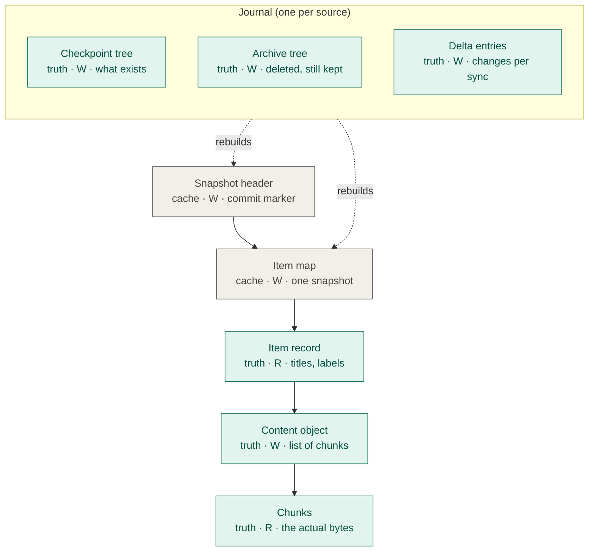
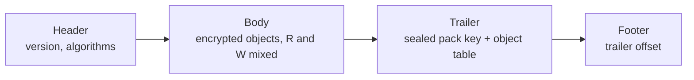
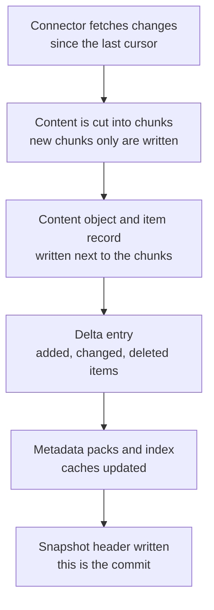
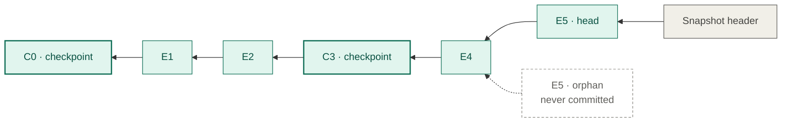

# How the NilPerit format fits together

> **Not normative.** This is an informal explainer for humans. The rules are in [format.md](format.md). If the two disagree, format.md is right and this document has a bug. Keep this document in sync when the format changes.

This page explains what NilPerit stores, where it stores it, and how history builds up over time. It uses the terms from the [glossary](glossary.md).

## The two questions to ask about any object

Almost everything NilPerit stores is an **object**. The exceptions are the plaintext files of the vault: the config, the copy of the specification, the schema, the recovery software, and the lock file. For every object, two questions matter:

1. **Is it truth or cache?**
   - **Truth** cannot be recreated. Losing it loses data.
   - A **cache** can be rebuilt from the truth. Losing it costs time, never data.
2. **Who can open it?** This is its **key class**.
   - **R**: only the owner's read key. Used for the data itself and anything that describes it.
   - **W**: the writer key, so both the node and the owner. Used for the structure the node must read back: lists of IDs, trees, the journal.

| Object | Truth or cache | Key class | What it holds |
|---|---|---|---|
| Chunk | Truth | R | A piece of the actual bytes |
| Content object | Truth | W | The ordered list of chunk IDs for one content |
| Item record | Truth | R | Title, timestamps, labels, native ID, references to content |
| Journal entry (delta or checkpoint) | Truth | W | What changed in a sync, or the full state |
| Checkpoint tree, archive tree | Truth | W | The full state at a checkpoint |
| Item map, archive map | Cache | W | A fast view of one snapshot or of the archive |
| Snapshot header | Cache | W | Entry point for one snapshot; marks the journal head |
| Index | Cache | W | Where each object is: pack, offset, length |

The pattern: **anything sensitive is R** (bytes, names, subjects, labels), and **the node only ever sees opaque IDs and structure** (W). A server that holds only the node credential can add data and clean up, but it cannot read anything.

## The object model

From a snapshot down to the bytes, and the journal next to it:



- An **item** (one email, one file) is described by one **item record**. The item record points to one or more **content objects**; for Gmail, that is the raw RFC 822 message.
- A **content object** lists the **chunks** of that content in order. Identical chunks are stored once, whichever item or source they come from.
- **Item maps** and **snapshot headers** are only shortcuts. The real history is in the **journal**.

## Where it sits on disk

```
vault/
  config            plaintext, with a MAC   format version, algorithms, read public key
  FORMAT.md         plaintext               copy of format.md
  schema/           plaintext               CDDL schema dictionary
  recovery/         plaintext               bundled reader software
  packs/ab/ab12…    encrypted               data packs (truth) and metadata packs (cache)
  index/            W                       index segments (cache)
  snapshots/        W                       snapshot headers (cache)
  condemned/        W                       condemnation records
  locks/            plaintext               writer lock
```

- The **plaintext** files contain no data of the owner. They exist so that a reader can find out what it is looking at before it has any keys, and so a vault can be read without NilPerit.
- **Data packs** hold the truth. An item record usually sits in the same data pack as its chunks, so a damaged pack only affects the items inside it.
- **Metadata packs** hold caches, including copies of item records, so a half-synced replica can still list everything and show what is missing.
- **Condemnation records** are not truth. If they are lost, nothing gets deleted until retention runs again and writes new ones. That is the safe direction.

### Inside one pack



- The **pack key** opens the R objects. It is sealed to the read key with a hybrid post-quantum KEM, so only the owner can open it.
- The **object table** (W) lists every object in the pack: object ID, type, key class, offset, length. The node reads it to rebuild the index and to clean up, without ever opening an R object.
- The **name of a pack** is the hash of the whole encrypted file. Anyone can detect a damaged pack without keys.

## IDs and hash domains

Every object has an **object ID**: a keyed BLAKE3 hash of its type and its stored bytes. Because the ID does not depend on the random encryption nonce, the same object has the same ID in every replica. That is what makes deduplication and repair from another copy work.

NilPerit makes three kinds of keyed hash, each in its own **hash domain** with its own key, derived from the dedup key:

| Hash domain | Hashes | Used for |
|---|---|---|
| Object ID | type ID + stored bytes | Identifying every object |
| Item key | source ID + native ID | Keys in the trees, so the node never sees a message ID or a file path |
| Content hash | the full plaintext of a content | Checking a whole file after reassembly |

Because the domain keys differ, a value of one kind can never equal a value of another kind, whatever the input.

Two rules keep IDs stable forever:

- **Deterministic CBOR.** The same object always encodes to the same bytes, and a reader rejects anything else.
- **No re-encoding.** NilPerit hashes and copies the stored bytes exactly as written, never a fresh encoding.

## What happens during a sync



- Each step writes files under a temporary name, syncs them to disk, and then renames them. The snapshot header comes **last**: until it exists, the sync has not happened.
- A crash at any earlier point leaves only **orphans**: harmless files that the next run either reuses or cleans up later.
- During a long first sync, NilPerit commits at intervals, so a crash only loses the last few minutes of work.

## How history builds up

Each journal entry points to its parent. Arrows point back in time.



1. **Every sync adds a delta entry** (E1, E2, …) with only the changes.
2. **Every so often, a checkpoint** (C0, C3) records the complete state:
   - the **connector cursor**, so the next sync continues from here and does not read the whole source again;
   - the **checkpoint tree**: every item that exists at that moment;
   - the **archive tree**: every item version that is gone but still within its retention, with when it was first and last seen.
3. **The current state is the newest checkpoint plus the deltas after it**: here C3 + E4 + E5. NilPerit never needs to replay further back. The connector cursor to continue from is the one in the head (E5).
4. **The snapshot header marks the head.** Newest means the highest sequence number, not the latest clock time.
5. **A crash leaves an orphan.** An entry that was written but never committed is ignored; the next sync builds on the real head. This is not an error and not a fork. A **fork** is only two *committed* entries with the same parent, which can only come from two writers or from damage. NilPerit reports a fork and never resolves it on its own.

Checkpoints are cheap. The trees share every unchanged branch with the previous checkpoint, like Git trees, so a mailbox of 100,000 messages with 50 changes writes only a few dozen small nodes.

## How data is removed

Nothing is deleted immediately, and nothing is deleted because the source deleted it. Only retention removes data, in three steps:

1. **Compaction.** Journal entries and trees cannot change, so NilPerit writes a new checkpoint that keeps only what retention still wants. For example, the new archive tree leaves out item versions whose retention has expired.
2. **Condemn.** The journal range before that checkpoint is marked for removal. This can still be undone.
3. **Sweep.** Later, NilPerit walks everything reachable from the live journal and removes packs whose objects are all unreachable and have been condemned for longer than the grace period. Packs that are mostly unreachable are rewritten.

The sweep works from the truth, never from counters, so a failure at any point can only leave extra data behind. It can never remove data that is still in use. And it needs no read key: everything it walks is W.

## Where to go next

- [format.md](format.md): the normative rules, with test vectors.
- [glossary.md](glossary.md): every term, one meaning each.
- [decisions/](decisions/): why each part works the way it does.
